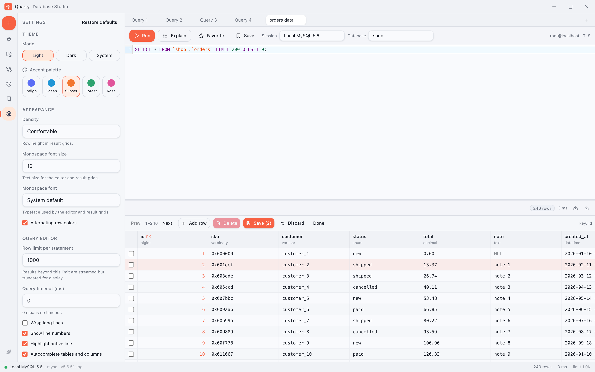
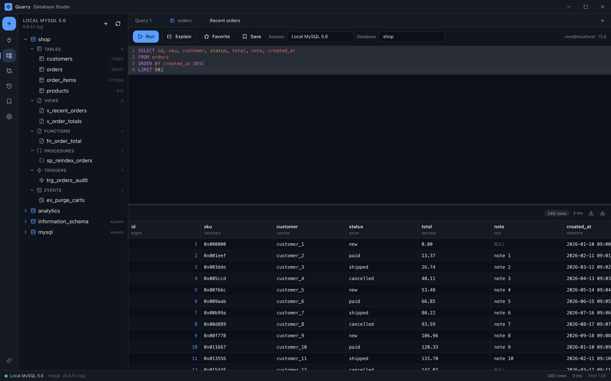
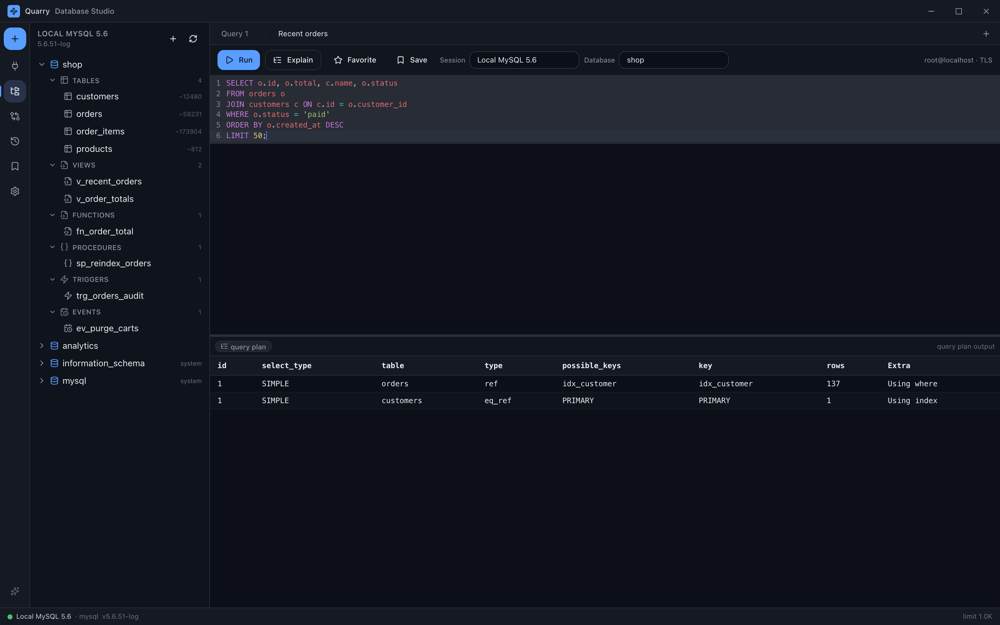
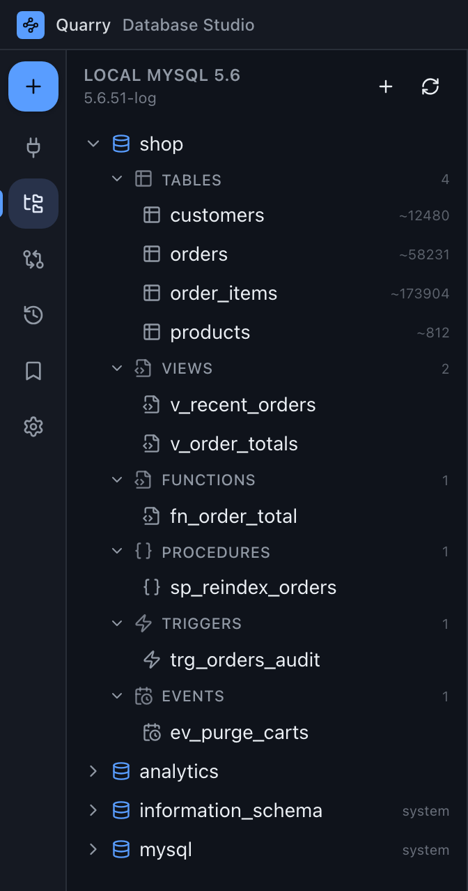
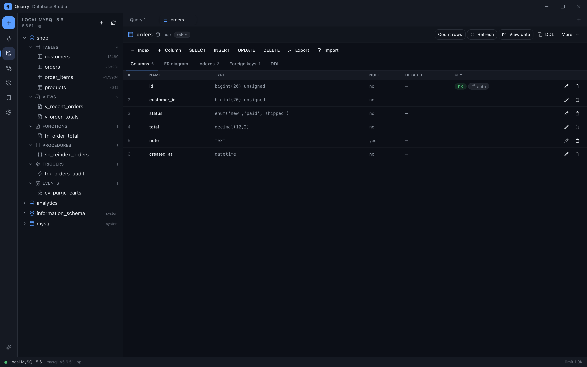
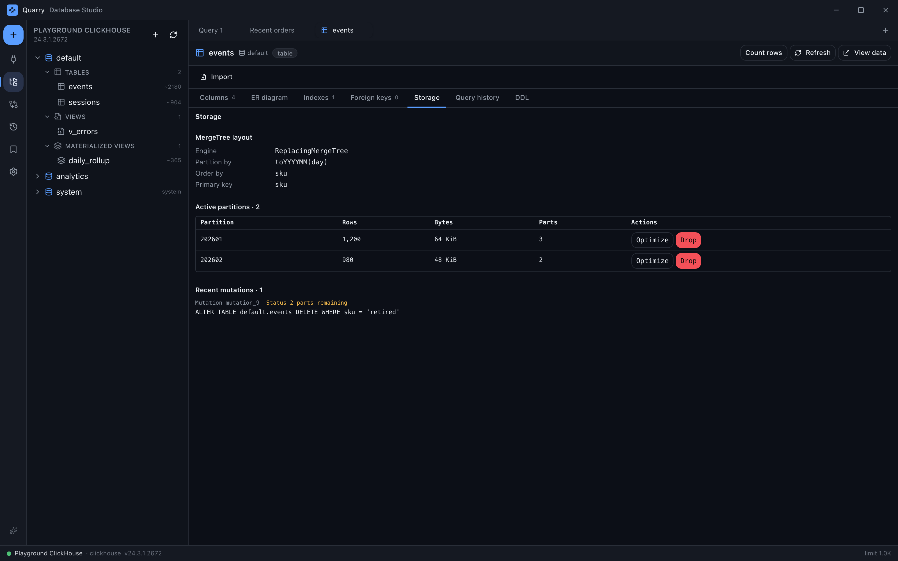
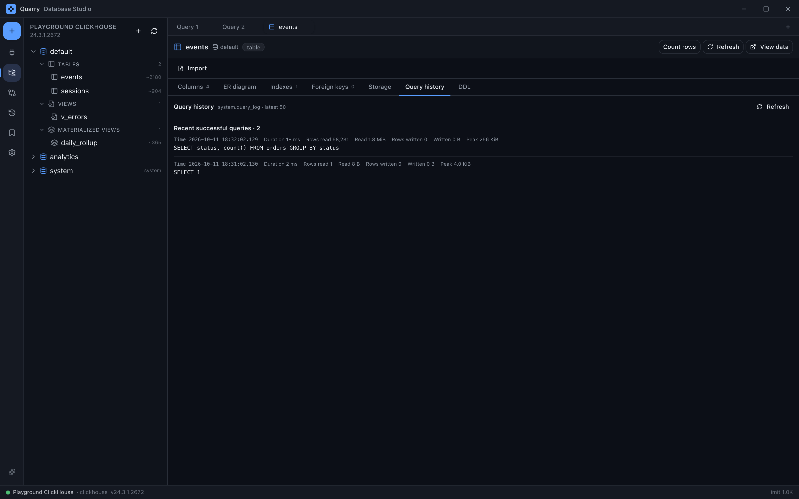
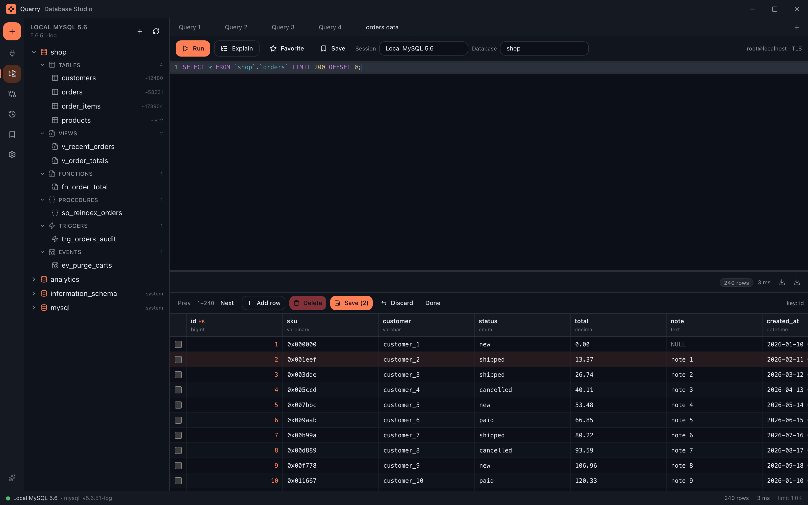
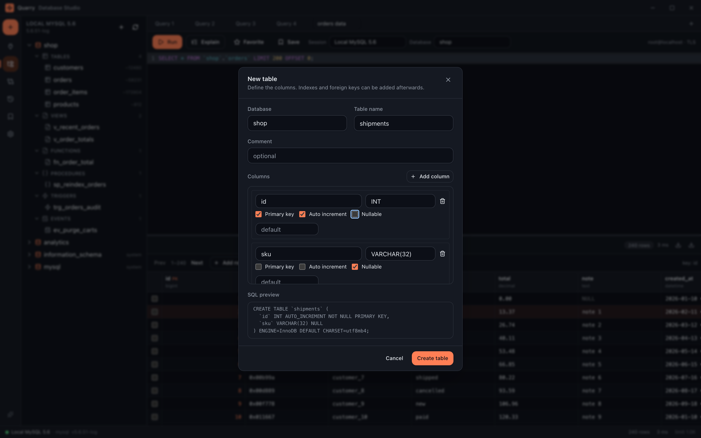

# Quarry

A **modular, themeable database studio** written with Tauri v2 (Rust) + React.
Today it supports **MySQL 5.6**, **PostgreSQL**, **SQLite**, **Redis**, **MongoDB** and **ClickHouse**;
the architecture lets you add new engines by writing only a new adapter.

> The name comes from "quarry": you dig the data out, and the node network in its icon
> represents databases connected from a single place — the node colors are taken from the
> app's five accent palettes.


## Why modular?

The whole application is built on a single abstraction:

```
                 ┌───────────────────────────────┐
   Frontend  →   │  Tauri commands (commands.rs)  │  → driver-agnostic
                 └───────────────┬───────────────┘
                                 │
                 ┌───────────────▼───────────────┐
                 │   DriverRegistry  (registry)   │
                 └──┬──────────┬──────────┬─────┬──┘
                    │          │          │     │
             ┌──────▼────┐ ┌───▼──────┐ ┌─▼────┐ ┌▼────────┐
             │  MySQL    │ │PostgreSQL│ │SQLite│ │  Redis  │   … MongoDB, ClickHouse
             │  adapter  │ │ adapter  │ │adptr │ │ adapter │
             └───────────┘ └──────────┘ └──────┘ └─────────┘
```

Two traits define everything (`src-tauri/src/drivers/mod.rs`):

| Trait | Role |
| --- | --- |
| `DatabaseDriver` | Represents an engine: identity, capabilities, dynamic form schema, `test()` and `connect()` |
| `Connection` | An open connection: `list_databases`, `list_namespaces`, `list_objects`, `describe_object`, `execute` |

The UI never contains driver-specific code. Differences are carried by two mechanisms:

- **`DriverCapabilities`** — `supportsSchemas`, `isRelational`, `resultShape`, `objectKinds`,
  `supportsTransactions` … The frontend decides which panel to show based on these flags.
  For example, MySQL has no schema layer, so it returns `supportsSchemas: false` and the tree
  skips the schema level, while PostgreSQL shows schemas as a real level.
- **`configFields`** — the connection form is generated from the fields the driver declares.

## Adding a new database

1. Open `src-tauri/src/drivers/<engine>.rs` and implement the `DatabaseDriver` + `Connection`
   traits (the MySQL/PostgreSQL/SQLite/Redis files can be used as templates).
2. Add the line `registry.register(Arc::new(MyDriver::new()));` to
   `DriverRegistry::with_builtins()` in `src-tauri/src/drivers/mod.rs`.
3. Add the dependency to `Cargo.toml`.
4. Feed the browser mock too (§Quality checks): refresh `src/lib/fixtures/driver-descriptors.json`
   first so the drift check can show the difference, then add the engine's `EngineFixture` to
   `src/lib/mockFixtures.ts` and align until `npm run check:drift` is green.

**Not a single line changes in the IPC layer, `commands.rs` or the UI.** On the next launch the
driver automatically appears in the `list_drivers` output and the connection form builds itself.

An engine declares its own quoting dialect (`DatabaseDriver::dialect`) and how a read is explained
(`DatabaseDriver::explain_statement`, or `None` if it cannot) on the driver; every connection
carries the driver it was opened from and answers its identity, capabilities and those two
questions only from there, so there is exactly one implementation and the mock check can see them.

A driver also adds its own tabs to the object inspector: it declares a panel with
`Connection::inspect_sections`, supplies a body that refreshes on demand with `section_body`, and
runs the operations the section exposes with `run_section_action`. This way no engine-specific
field is added to the `ObjectDetail` DTO; tab rendering is built entirely from generic blocks
(field list / table / record list).

## Tech stack

**Backend (Rust)** — Tauri v2, `tokio`, `sqlx` (MySQL + PostgreSQL + SQLite, rustls), `redis`
(connection pool + rustls TLS), `aes-gcm`
(encrypted local vault for passwords), `serde`, `thiserror`, `tracing`.

**Frontend** — React 19 + TypeScript + Vite, Tailwind CSS v4, shadcn-style components,
`zustand`, CodeMirror 6 (SQL — only on relational drivers), `@tanstack/react-virtual`
(results grid), `lucide-react`.

## Project structure

```
src-tauri/
  src/
    commands.rs        # IPC surface (driver-agnostic)
    drivers/
      mod.rs           # traits, capabilities, registry
      mysql.rs         # MySQL 5.6+ adapter
      postgres.rs      # PostgreSQL adapter
      sqlite.rs        # SQLite adapter (embedded; end-to-end tests need no server)
      redis.rs         # Redis adapter (one command per line; reply→row mapping + tests)
      mongo.rs         # MongoDB adapter (JSON command documents; cursor reads + tests)
      clickhouse.rs    # ClickHouse adapter (HTTP; system tables + tests)
    ddl.rs             # dialect-aware DDL generator (create/alter/index/drop) + tests
    models.rs          # serde DTOs (mirror the frontend types)
    session.rs         # open-connection manager + running-query registry (cancel)
    secrets.rs         # encrypted local vault (AES-256-GCM)
    store.rs           # profile + settings + saved-query persistence (JSON)
    sql_split.rs       # quote/comment-aware SQL splitter (+ tests)
    scripts.rs         # read/write .sql script files (+ tests)
src/
  components/          # layout, ui, connections, explorer, query, objects, history, snippets, settings
  lib/                 # typed IPC, updater, types, dev mock (fixtures + reply mapping), helpers
  stores/              # theme + workspace + updater state
  theme/               # palette definitions
```

## Setup

```bash
npm install
npm run tauri:dev      # run the desktop app in development mode
npm run tauri:build    # produce a signed/packaged application
```

> **A packaged build needs the updater key.** `bundle.createUpdaterArtifacts` is on, so
> `npm run tauri:build` signs the update bundles and fails without
> `TAURI_SIGNING_PRIVATE_KEY` (for `build`/`bundle` this may be the key's contents *or* a path to
> the key file) — see [Updates and releases](#updates-and-releases). `npm run tauri:build -- --debug`
> behaves the same way; pass `-- --config '{"bundle":{"createUpdaterArtifacts":false}}'` for a
> throwaway local bundle you do not intend to ship.

To work on the UI only:

```bash
npm run dev            # http://localhost:1420 — opens in the browser with demo data
```

> **Browser demo mode:** outside the Tauri shell (when `__TAURI_INTERNALS__` is absent)
> `src/lib/mock.ts` takes over. The data is produced by the **per-engine fixtures** in
> `src/lib/mockFixtures.ts`: the profile, session, databases/schemas, object tree, introspection,
> EXPLAIN plan, dialect quoting, row estimates and the inspector sections the driver declares are
> all defined there for every compiled-in driver. `list_drivers`, `list_connections`,
> `list_sessions` and all introspection commands are generated from that table, so adding a new
> engine is adding a single entry; `src/lib/mock.test.ts` verifies that the fixtures are consistent
> with the adapters. The artificial latency of the commands is set with `mockLatency`
> (`min`/`max` = 0 → no wait; the tests use this). This path never runs in the packaged app.

## Quality checks

```bash
npm run typecheck                      # tsc --noEmit
npm test                               # node:test — src/lib helpers, src/components, scripts
npm run check:version                  # package.json ↔ Cargo.toml ↔ tauri.conf.json
npm run build                          # tsc + vite build
cargo test  --manifest-path src-tauri/Cargo.toml
cargo check --manifest-path src-tauri/Cargo.toml
```

Because SQLite is embedded, the driver tests (with `:memory:` and a temporary file) run in the
normal test run **without a server**. All of the list above runs on every push and pull request
(`.github/workflows/test.yml`): the `js` job does the version check, the typecheck and `npm test`,
the `rust` job does
`cargo fmt --check`, `cargo clippy`, `cargo test` and then the frontend half of the drift check
(the webview and packaging libraries are installed first, since even `cargo check` links them).
The cargo steps run `--locked`, so a Cargo.toml change without a matching lock file fails the run
instead of silently resolving something the tests never saw. Clippy lints are reported but not
fatal — the tree still carries a handful of pre-existing ones — while `cargo fmt --check` and
`npm run check:version` are hard gates. Every action in both workflows is pinned to a commit SHA
(a moved tag in the release job would be a way to ship a signed malicious update); Dependabot
proposes the upgrades (`.github/dependabot.yml`).

**Component tests.** `npm test` also renders React components and asserts on what they produce
(`src/**/*.test.tsx`), so a UI regression is caught by the suite instead of by a hand-run browser.
They run under the same `node:test` runner as `src/lib`: Node strips types from `.ts` but refuses
JSX and knows neither the `@/` alias nor Vite's extensionless imports, so `scripts/tsx-loader.mjs`
supplies that one transform by borrowing the `typescript` already installed for `npm run typecheck`.
Two helpers carry the rest, and both are test-only — neither is reachable from `src/main.tsx`, so
`npm run build` leaves them out of the bundle.

- `src/lib/testBackend.ts` replaces the backend. `installTestBackend({ list_connections: … })`
  scripts replies, records every command with its payload (`backend.argsFor("list_databases")`),
  and — deliberately — *rejects* a command no test scripted, so a forgotten reply fails the test
  instead of quietly rendering an empty state that looks like a passing assertion.
- `src/lib/testRender.tsx` gives those components a document. `react-dom/server` is not enough for
  anything that reads a store: zustand hands `getInitialState` to `useSyncExternalStore` as the
  server snapshot, so markup rendering would show the state the module was created with and never
  what the app has loaded since. `mount()` renders into jsdom instead, which runs effects and lets
  `click(view, "Connect")` drive a real event.

`src/components/connections/ConnectionList.test.tsx` uses both: it boots the real store over
scripted replies, asserts the commands and payloads that boot sends, clicks Connect to watch a
command change the list, and checks that a missing reply reaches the UI as an error.
`src/components/query/DatabaseSelect.test.tsx` is the opposite end — a presentational leaf whose
labels are pinned from markup alone, with no document and no backend. That is where it belongs:
its placeholder must never repeat a database name, which is how ClickHouse's real `default`
database collided with the old `default` placeholder.

What still has to be verified by hand: Tauri itself (the double replaces the shell, it does not run
it) and anything needing a real server, which the per-engine mock at best imitates.

**Mock ↔ Rust drift check.** Since the browser mock re-declares each engine's surface,
`src/lib/fixtures/driver-descriptors.json` is the contract between the two languages. On the Rust
side the `descriptor_snapshot_matches_the_registry` test checks that file against the registry,
and on the TypeScript side `src/lib/fixtureDrift.test.ts` checks `src/lib/mockFixtures.ts` against
the same file. If a capability flag, object kind, context-menu action, connection field, identifier
quote character or `EXPLAIN` statement exists on only one side, the test turns red — they cannot
silently diverge. A driver declares those two facts itself through `DatabaseDriver::dialect` and
`DatabaseDriver::explain_statement`; every connection carries the driver it was opened from and
answers its identity, capabilities and those two facts only from there. The `npm test` side also
compares the mock's `explain_query` reply directly against that declaration. After deliberately
changing a driver:

```bash
QUARRY_UPDATE_SNAPSHOT=1 cargo test --manifest-path src-tauri/Cargo.toml descriptor_snapshot
npm run check:drift   # runs both halves together
```

To try a driver end to end against a real server (skipped by default):

```bash
QUARRY_TEST_MYSQL_HOST=127.0.0.1 \
QUARRY_TEST_MYSQL_USER=root \
QUARRY_TEST_MYSQL_PASSWORD=secret \
QUARRY_TEST_MYSQL_DATABASE=shop \
cargo test --manifest-path src-tauri/Cargo.toml -- --ignored --nocapture
```

For Redis, pass `QUARRY_TEST_REDIS_HOST` to the same run (optionally `_PORT`, `_USER`,
`_PASSWORD`). For MongoDB use `QUARRY_TEST_MONGO_HOST`, and for ClickHouse
`QUARRY_TEST_CLICKHOUSE_HOST` (both also accept optional `_PORT`, `_USER`, `_PASSWORD`).

**What a keystroke costs.** A question to the decision model takes ~450 ms, so the work in
`src/lib/rankCache.ts` is all about not asking. A question is the line *plus* the list of tables it
offers, and:

- a repeat is served from memory, and a question already in flight is shared rather than doubled;
- a line that is merely longer than one already answered over the same tables is answered from
  that — reuse is refused unless the choices are identical, because the model was measured
  switching its pick the moment the fragment pointed at a different name;
- a question waits 150 ms (`SETTLE_MS`) for the writing to stop, and a line that arrives during
  that wait replaces the one that has not gone out yet and starts the window again.

What a request may contain is bounded on **both** sides, and both bounds are measured rather than
chosen. The editor trims what it sends: the tail of the line (`MAX_STATE_CHARS`, 2000 characters — a
minified one-line script can be huge and the model only needs what surrounds the cursor), the head of
the statement (`MAX_STATEMENT_CHARS`, 4000 — the head is what names the statement's kind and its
table, which is what that question turns on) and at most a dozen names (`MAX_RANK_CANDIDATES`). The
client bounds the same fields again (`MAX_*` in `src-tauri/src/decision.rs`) as the last line of
defence in front of the model: 4 KB of line, 4 KB of statement, 26 names. Deliberately not the same
numbers, because that side is not enforcing the editor's policy — it bounds the work one keystroke
can ask of this machine, and a caller that forgot to trim (a bug, or something that is not the
editor) must not be able to ask for an arbitrarily large prompt. A request that is merely too big is
truncated rather than refused, which is what the editor does with a long line itself; measured end to
end, one carrying a 360 KB line, a 400 KB statement and 500 names reaches the endpoint as 4 KB, 4 KB
and 26 names.

What those bounds cost, and why they are those numbers, is measured against `nimble` on this machine:
~620 ms for a typical keystroke (a 30-character line, three names), ~3.4 s for the largest request
the editor itself can send (a 2 KB line, a 4 KB statement, 12 names) and ~5.2 s at the client's bound
— so the backstop cannot make the machine do much more than the app already asks of it, and it stays
far from the backend's 20 s budget. The endpoint has walls of its own, both just above the model and
both found by asking it: more than 26 criteria is refused outright (`HTTP 400 criteria must contain
2–26 candidates`) and text past 64 KiB is refused as too big (`HTTP 413 text and schema must not
exceed 64 KiB`). The first is why the candidate bound is 26 and no higher — a bound *above* the
endpoint's would turn a request that is merely too large into a hard failure ("no model answered"),
which is the one outcome the bound exists to avoid.

The list itself never waits for the model either. `src/lib/smartComplete.ts` hands back what the
language's own sources produced straight away, puts the question behind it, and rebuilds the open
list when the answer lands — as long as the editor is still completing that same place. That second
pass finds the answer in the cache, so it asks nothing and cannot rebuild a third time; a caller
that passes no cache has each place rebuilt once and no more.

**The second question rides in the same request.** The editor asks the model two things at once and
the reply carries both: which table the identifier means (a `choice`), and how far running each
statement a command would send could go — one graded question per statement, answered as a position
on a four-step scale (a `score`). `/v1/systemone` answers a *set* of named questions from one
`state` in one round trip, so a reading costs a question rather than a call — measured against
`nimble`, the ranking alone took 257 ms and the pair 437 ms. The halves are read independently, so
a model that answers one and not the other still says something, and each reading is filed under
the statement it was asked about.

The scale and the wording of the question were both chosen by measurement, because a real model
answers the literal reading of a question. Asked whether a statement merely "modifies data", it
scores a bounded `UPDATE ... WHERE id = 1` at ~1.0 exactly as it scores `DROP TABLE`, which is
useless as a warning; the scale it was finally given answers by *kind* — reads and changes nothing,
writes a bounded number of rows, removes every row, removes a table — and over nine statements the
answers came back ordered the way the steps are: `SELECT ... WHERE id = 1` 0.01, `CREATE INDEX`
0.11, `ALTER TABLE ... ADD COLUMN` 0.73, a bounded `UPDATE` 1.00, `INSERT` 1.01, a one-row
`DELETE` 1.05, `DELETE FROM orders` 1.87, `TRUNCATE` 1.98, `DROP TABLE` 3.00 (`RISK_SCALE` in
`src-tauri/src/decision.rs`, where the numbers are recorded). The position is rounded to the
nearest step — ties to the lower one — and that step is the `verdict` the client reports. Which
steps are worth a warning is the editor's policy (`src/lib/statementRisk.ts`): the two that take
something away are marked, in the words "Removes every row" and "Removes a table", and a bounded
write is deliberately silent — measured, a one-row `DELETE` and a bounded `UPDATE` sit on the same
step, and an ordinary edit is not what a warning is for.

What that buys is a warning before Run rather than after, and about the statements a command would
*send*: the selection when there is one — a selection can hold several statements, and Run sends
all of them — otherwise the statement under the cursor, resolved through the same function the
button resolves its text with, so the question cannot drift from the run; and the Script button's
mark is about the whole file, whose readings fill in a dozen statements per settle. A reading
belongs to the exact statement it was asked about and to nothing else — each one echoes the
statement as it was sent — so `DELETE FROM orders` never lends its reading to
`DELETE FROM orders WHERE id = 1`, and a statement with no reading has none, which is not the same
as a safe one. When no ranking request has carried a statement, the editor asks about it on its own
after the same settle window. It is all on the same switch as ranking and equally best-effort: a
model that is missing, slow or unsure costs the ranking, the badge and nothing else.

The scale has one measured blind spot, and the statement's own text closes it. An `UPDATE` that
names no row reads as a bounded write — 1.06, against 1.00 for a bounded one — because the question
turns on what the statement does and not on what it fails to name. So a reading is *floored*: an
`UPDATE` or `DELETE` whose text bounds itself with neither a `WHERE` nor a `LIMIT` at the top
level (a `TRUNCATE` outright) is marked at the rows step whatever the model read — raised, never
lowered, with the model's position and confidence kept on the reading and the tooltip quoting both
voices. The check reads the statement's own tokens, with literals, comments, quoted identifiers and
dollar quotes blanked by a scanner that mirrors the splitter's, so a `WHERE` inside a string or a
subquery bounds nothing; a statement cut at the head is out of its reach, because its tail was read
by nobody and the model's answer stands alone (`presented` and `reachesEveryRow` in
`src/lib/statementRisk.ts`).

**A statement that failed is a question of its own.** The decision layer carries a third question
beside those two, and it is the only one whose subject is not the line being typed: a command came
back with an error, and the model is asked which of the schema's names the SQL that did not run most
likely meant. The request therefore carries both halves of the failure — the failing SQL in its own
state block and the database's own error in another — and the wording names the block the SQL is in,
because the model has to tell the statement apart from the error beside it. A repair question with
only one of the two is not a question: it is answered the way a missing model is, with no call made.

The names to choose between are the schema's, plus one criterion that is not a name at all —
`none of the listed names is the one it meant` — so declining is an answer the question can be given.
That criterion counts like any other to the endpoint, which refuses more than 26 of them (measured
above), so a repair request carries one name fewer than a ranking one. A model that names it is not
producing a ranking: the client turns that into an empty one and passes the reason on in its own
words (`no listed name fits the error`), because a suggestion that picked a name when the schema had
none would send the reader to a name their SQL never meant.

Measured against `nimble` on this machine over seven failures — a mistyped column, a mistyped table
and a mistyped schema-qualified table across SQLite, MySQL and PostgreSQL, plus two failures nothing
in the schema fits — the model named the intended name in six of them, at 0.94 to 0.99, and on
`no such column: profit_margin_eur` against a schema holding none of those words it chose the
criteria's own decline (0.941). The one it missed is worth keeping: `SELECT * FROM order_number` — a
column name in a table position — came back `orders`, which is a repair a person might well make, and
which the decline criterion does not cover. What the feature needs is that the confident answers are
right and that a schema with nothing close produces nothing, and that is what this run shows; one
answer is one answer, and the wording is `REPAIR_INSTRUCTION` in `src-tauri/src/decision.rs`, asked as
`CandidateKind::Repair`, where the numbers are recorded beside it.

**What the editor asks it about is decided on this side.** A schema can hold hundreds of names and one
repair request may carry 25 of them, so `src/lib/statementRepair.ts` builds a shortlist before anything
is sent — and the shortlist is the design. Names are scored against the identifiers the *error* itself
names (`ordred_at`, `quanity`, `oder_number`, `shop.ordres`), because that is where the typo is in every
dialect's wording, and only those within `REPAIR_SIMILARITY` are offered: the measured mistakes sit at
0.67 and above, a column name used where a table belongs is a partial match on its prefix (0.42), and a
name the error is not about falls below the floor — `no such column: profit_margin_eur` scores 0.24
against the closest name in the demo schema, so that failure is never put to the model at all. Not
asking is cheaper than a declination and at least as honest, and it is what makes the hint something a
reader can act on rather than a guess with a model's name on it.

The SQL is deliberately *not* scored, though it is what the model is shown. Its names are valid names
by definition, so each would match itself at 1.0 and drown out the typo the question exists for —
`SELECT * FROM orders WHERE profit_margin_eur = 1` would offer `orders` as a perfect candidate for a
failure in another name entirely. A shortlist of one name is still asked about, because the question
carries its own "none of these" criterion and can always be declined; a shortlist of none is not a
question.

A failure is an event rather than a position, so it does not wait for a keystroke to settle: the run's
failed statements are read once from its results, asked about once, and the answer is filed under the
statement *and* the error it was given for — the same statement failing two ways is two questions, and
a declination is an answer that is not asked again. The hint itself is drawn under the database's own
error, not instead of it, and only when the layer below actually ranked the answer: a declination and an
unsure answer both arrive with an empty `ranked` while still filling in `choice`, so `choice` alone is
not a suggestion and is never shown as one. It is on the same switch as the ranking, and it is
best-effort in the same way — a model that is missing, slow or sure of nothing costs the hint and
nothing else.

**And the hint can be pressed.** A suggestion a reader has to retype by hand is half a feature, so the
name is offered with a **Fix and run** button that writes it into the statement in the editor and runs
it. Which word the answer is about is a fact about the text rather than about the model, so it is
recomputed here (`repairTarget`): the word has to be one the *error named* — a suggested name that
merely happens to be close to some other word in the statement is a coincidence, not a repair — it has
to be *in the statement*, and it has to be close to the suggested name under the same floor the
shortlist was built with. Every whole-word occurrence is replaced, because a typo is a typo wherever it
appears: a `SELECT` list and its `WHERE` clause usually spell the same mistake twice, and mending one of
them would leave the statement failing for the same reason. Nothing else in the text is touched, so a
repair can only ever change the name that was got wrong — quoting is the writer's, and only the word
inside the quotes is replaced.

The button only appears while the statement it would mend is still in the editor; the SQL having been
edited since the failure means there is nothing to put right, and a control that changed nothing would
be worse than no control. What it does is said in its tooltip before it is pressed, because a button
that rewrites the editor and runs it should not have to be discovered. Nothing is remembered as
"fixed": a repair that fails anyway is a new failure with its own error, and it is asked about like
any other.

**A dotted completion asks about columns.** A bare identifier asks which *table* is meant; one after
a qualifier — `orders.ord` — asks which of that table's *columns*. Nothing downstream of the
candidates changes: the same cache, the same boosts by label, the same "the list is shown first and
reordered when the answer lands". Only the question's wording changes, and it travels as `kind` so
the model is told what it is choosing between (`the order_number column`, not `the order_number
table`).

What the language actually offers behind a qualifier was measured against `@codemirror/lang-sql`
rather than assumed, because it decides which of these can work at all: `orders.` offers that table's
columns, `shop.ord` offers that schema's tables (so the question stays a table question there, and
only the tables on screen are asked about — `order_archive` in another schema is not), `shop.orders.ord`
resolves like the first case because the identifier next to the dot is the table's, and an **alias**
— `o.` in `FROM orders o` — offers the bare list instead. The language does not resolve aliases, so
`orders`' columns are not behind `o.` at all; offering them would mean adding names it never offered,
which is a different feature from ranking the ones it did. `o.ord` is therefore completed exactly as
it was before.

How a qualifier may be **spelled** was measured the same way, because a spelling the editor did not
recognise would drop the ranking silently rather than fail: a double-quoted identifier is the same
qualifier — `"orders".` offers exactly the columns `orders.` offers — so the quotes are taken off and
the name is read, which is what `"shop"."orders".ord` needs too. Backticks and brackets are *not*
treated as one, because the language does not resolve them either: `` `orders`. `` offers the bare
list rather than that table's columns. The language matches a name **exactly**, case included —
`ORDERS.` and `"ORDERS".` offer nothing at all, and `"orders".` offers nothing when the schema
spells the table `Orders`. This editor is deliberately more forgiving than that, since SQL names are
case-insensitive on most engines, but a question is only worth asking about names the list is
actually showing: one whose candidates are all absent from it is not sent, so an uppercased qualifier
costs no model call and a quoted one is ranked like any other. The same rule catches the documents the
language's own parser has not caught up with — a 3.6 KB one-line select list of a thousand names
offers the keyword list and no tables at all — where there was nothing to reorder either.

How good the column answers are is measured too, and they are **weaker than the table question**:
the model does read the statement (`SELECT date_trunc('day', o.ord)` over `order_number < ordered_at <
order_status` answers `ordered_at`, 0.835, and the live test above prints what it answers for a
`WHERE` clause — 0.489 for `order_number` on a line that also names `order_status`), but three
wordings of the question all named `order_number` for `SELECT * FROM orders o ORDER BY o.ord`, the
same case answered between 0.03 and 0.20 as the state around it changed, and a column the statement
does not point at is sometimes named. The cost of a wrong pick is bounded by design — names are only
ever *reordered*, never added or removed, so a wrong one costs the reader a row — and an answer the
model is not sure enough about (`MIN_CONFIDENCE`, 0.15 in `src-tauri/src/decision.rs`) is not acted
on at all.

**A list that keeps its own order says which question it was asked.** Because an unsure column
answer is the ordinary case behind a qualifier rather than a fault, the toolbar's pill separates the
two ways a list can end up unranked: it reads `AI unavailable` when no model answered at all ("is
Ollama running?") and `AI unsure` when an answer arrived without enough conviction — and in that
second case its tooltip names what was being chosen between ("which column you meant", not "which
table") and quotes the client's own reason verbatim, number included ("the model was not sure enough
(0.32 below 0.15)"). Without it, a reader is left to guess between a broken assistant and a question
the model finds hard. The states and every sentence they show live in `src/lib/assistantStatus.ts`;
the workspace supplies the facts and the pill only draws them.

Measured against `nimble`, the endpoint's own cache helps only for a request it has answered byte
for byte — an identical body returns in ~52 ms, while any change, one character of the line
included, costs the full prompt again (~450 ms). Serializing the volatile field before or after
the questions makes no difference (measured both ways), so the only lever is not sending the
request at all. Against a model that takes 200 ms to answer, six keystrokes of one word become one
question when they are typed without pausing; when the choices narrow partway through, one question
per set of choices — a genuinely different question, which is why the cache keys on the choices.

Reuse across a longer line rests on the model keeping its answer while the choices are unchanged,
which the live test below checks at every step of `orders` rather than assuming.

Smart autocomplete's model is verified the same way. With Ollama running and a decision model
pulled, this test ranks real candidates over the real endpoint and prints the latency, which is
the only place it is measured (the four- and twelve-candidate timings, and what typing costs as
opposed to repeating one line, all come from here):

```bash
QUARRY_TEST_OLLAMA=1 cargo test --manifest-path src-tauri/Cargo.toml -- --ignored --nocapture ranks_with_a_real_model
```

`QUARRY_TEST_OLLAMA_MODEL` picks the model (default `nimble`) and `QUARRY_OLLAMA_URL` the origin.
The client's budget is sized for a model that is not resident yet: Ollama drops one from memory after
a few idle minutes, and `nimble` took 7.25 s to come back, so the first question of a session is
answered rather than dropped. Nothing on screen waits for that answer — the suggestions are already
showing — which is what lets the budget be generous. The test prints the first call's latency and
reports any attempt that still missed.

Where that test asks the client, `npm run smoke:app` asks the **app**: it builds a bundle that carries
a probe (`src/lib/rankProbe.ts`, the arrangement `scripts/e2e-update.mjs` uses to press Install),
launches it on a generated SQLite demo, and has the app itself type the last character of
`SELECT * FROM ord` into the workspace's editor. The probe reports what the editor did with that
keystroke and the script judges the **sequence**: in the debug run above, the list opened unranked at
162 ms (`order_archive > order_items > orders`), the model answered at 713 ms, and the rebuilt list
read `orders` first at 772 ms (180 ms, 410 ms and 471 ms for the same run in the release profile). A list that already led with the table the model would pick, a ranking
that never arrived, and a list that never opened are three different failures with three different
messages — the run reports the editor's own completion state alongside the list on screen, so a
failure says why rather than merely that nothing happened.

The same run then carries a **failure phase**, because what the editor does with a statement the
database rejected is decided by an effect, a store and a request that no test outside the app can
see end to end: the probe runs `SELECT * FROM oder_items` once the ranking has been seen, reports the
error SQLite gave back and then the name the editor drew under it. What the script asserts is again a
steps of a sequence — a `failed:` step, a `repair:` step naming the real table, and then the button
pressed: a `fixed:` step holding the statement the editor was left with and a `ran:` step from running
it. So a hint that never appeared (the probe gives up with `timeout:no-repair`), a hint naming
something else, a repair never written and a repair written but not run are four faults with four
messages, and none of them can pass on the strength of the ranking alone. In the debug run above the
error was on screen at 5489 ms (`no such table: oder_items`), the suggestion — `order_items`, 95%
sure — at 6284 ms, and the editor was left holding `SELECT * FROM order_items` and had run it by
6328 ms.

The typing has to be real because nothing else can stand in for it; everything around it is checked
instead of assumed. The demo schema is built for the question — every table contains `ord`, and the
SQL names the one the language would list *last* — so a reordering is visible as a reordering rather
than as agreement. The failure phase's SQL is a mistyped `order_items`, which is the mistake the
repair question was measured on. Needs Ollama with a decision model pulled (`QUARRY_SMOKE_MODEL`,
default `nimble`); without one the run exits 2 before building. `-- --release` drives the profile a shipped
bundle is built in, which is slower but is the bundle that ships. A probe build is not a build to
keep — both the probe and the widened CSP are build-time choices — so the run puts back whatever
bundle it found in the target directory before it exits.

## MySQL 5.6 notes

- **TLS**: versions before 5.6.46 do not support TLS 1.2. Set the **TLS** field in the connection
  form to `Disabled`; the default `Preferred` uses passwords if the server supports them and a
  plain connection if it does not.
- Schema discovery uses only the `information_schema` tables that exist in 5.6.
- Type mapping: `DECIMAL` is carried as a **string** without precision loss, `BLOB/BINARY` with a
  `base64:` prefix, `DATE/DATETIME/TIMESTAMP` as ISO strings, and `NULL` separately from an empty
  string.
- Large results are streamed from the server and cut off on screen at the `editor.maxRows` setting
  (the `truncated` flag).
- Multi-statement scripts are split in a quote/comment-aware way and executed in order.
- The result of `SELECT VERSION()` is parsed and stored in `ServerInfo`.
- **Aliases in discovery queries are never reserved words** (or they are protected with backticks).
  5.6 does not accept reserved words such as `CURRENT_USER` as an unquoted alias, so neutral names
  like `... AS current_usr` are used.

## SQLite notes

- **Embedded file**: no server; the connection form consists only of the **Database file** path and
  the **Create if missing** option. If you type `:memory:`, an in-memory database pinned to a single
  connection is opened. Connection profiles show the file path instead of `user@host`.
- **No schema layer**: the databases `main` (and any `ATTACH`ed in that connection) are the root
  level of the tree; objects are read from `sqlite_master` and grouped as table/view/trigger.
  `ATTACH` is specific to the connection and may not be visible on another connection in the pool.
- **Introspection**: columns are read one by one with the `pragma_table_info`, indexes with
  `pragma_index_list`/`pragma_index_info` and foreign keys with `pragma_foreign_key_list`
  table-valued functions; for editor autocomplete all columns are collected in one query
  (`sqlite_master` ⋈ `pragma_table_info`).
- **Auto-increment key**: a single-column `INTEGER PRIMARY KEY` (rowid alias) counts as
  auto-increment, so SQLite assigns the PK left blank in the grid. When DDL is generated from the
  schema this column is written as `INTEGER PRIMARY KEY AUTOINCREMENT`; the MySQL-specific
  `ENGINE`/`KEY`/`AFTER`/`COMMENT` suffixes and the PostgreSQL-specific `CASCADE`/`USING HASH` are
  not produced in the SQLite dialect.
- **DDL differences**: `DELETE FROM` instead of `TRUNCATE`, no `DROP TABLE ... CASCADE`, `VACUUM`
  takes no table argument, and indexes are generated in separate `CREATE INDEX` statements rather
  than in the `CREATE TABLE` body. `ALTER COLUMN` supports **renaming** a column only; changing its
  type/constraints is rejected because SQLite would need to recreate the table.
- **EXPLAIN**: `EXPLAIN QUERY PLAN` is used (plain `EXPLAIN` dumps VDBE opcodes).
- **Cancel**: because it is embedded, server-side `supportsCancel` is **off**; the timeout still
  works (the IPC layer drops the future).
- **Types**: SQLite is dynamically typed; `BLOB` is carried with a `base64:` prefix, `REAL` as a
  number, `TEXT` as a string, and `NULL` separately. The `INTEGER`/`REAL`/`BLOB`/`TEXT` affinities
  are known, and remaining values are resolved from the value's own storage class.

## Redis notes

- **Not relational**: `queryLanguage: redis`, `resultShape: keyValue`, `isRelational: false`.
  Based on these flags the UI hides everything SQL-specific: the schema tree, the table wizard,
  qualified name / DDL copying, the SELECT/INSERT/UPDATE/DELETE templates, SQL autocomplete and
  `EXPLAIN`. The editor switches to plain-text mode instead of a SQL dialect.
- **Commands**: every non-empty line in the editor text is one Redis command (one command per line;
  with independent quote/escape-aware arguments, `#` comments are skipped). For example:
  a `SET user:1 Ada` line, a `GET user:1` line. This is compatible with scripts pasted from
  `redis-cli`.
- **Reply rendering**: a scalar reply becomes a single cell (`value`), scalar arrays become one row
  per element, nested arrays become a `col_1`, `col_2` matrix, and a RESP3 map becomes a
  `field`/`value` table. The `editor.maxRows` limit applies in the same way (the `truncated` flag).


- **Explorer**: keys are listed with `SCAN` (at most **2000** keys / 40 rounds) and shown in the
  `Keys` group; on very large keyspaces the list is a sample, not the whole thing. Clicking a key
  shows a summary of `TYPE`/`TTL`/`<type>LEN`/`STRLEN`; instead of a made-up `CREATE TABLE` the DDL
  tab writes the key's type and a runnable command.
- **Single database**: the session pins itself to the numbered database in the connection form
  (`supportsMultipleDatabases: false`); there is no live switching with `SELECT`.
- **TLS**: if `Required` is selected it connects over `rediss://` using the system certificate
  store; `Disabled` uses plain `redis://`. `Preferred` (not the default) counts as a plain
  connection.
- **Credentials**: `username`/`password` are percent-encoded into the URL; on servers without
  Redis 6 ACLs only `password` is required.

## MongoDB notes

- **Document-based**: `queryLanguage: mongo`, `resultShape: document`, `isRelational: false`.
  The explorer lists collections and views; SQL templates, DDL and `EXPLAIN` are not offered.
- **Commands**: the editor text is JSON command documents, e.g.
  `{"find": "users", "filter": {"age": {"$gt": 21}}}`.
  Multiple commands can be written back to back (separated by commas or semicolons); lines starting
  with `//` or `#` are comments. Mongo shell syntax (`db.users.find(...)`) is not supported.
- **Replies**: `find` and `aggregate` cursors are read with `getMore` up to the row limit; the reply
  of other commands is shown as a single row. Top-level fields become columns, nested values stay
  JSON, and BSON types are shown with extended JSON (`$oid`, `$date`…).


- **Data preview**: `View data` pages through a `find` sorted by `_id` (`skip`/`limit`).
  The ordering is fixed; there is no filter or sort UI.
- **Schema**: columns are derived from a sample of 200 documents (multiple types are merged; missing
  or null fields become nullable). Indexes are read with `listIndexes`.
- **Editing**: collection rows cannot be edited in the grid. Write commands (insert, update, delete)
  can be run as JSON from the editor.
- **Actions**: Inspect, View data, Count rows and Copy name. There is no rename, drop or truncate.
- **Connection and TLS**: only the `Required` TLS option exists (`?tls=true`, system certificate
  store). The authentication database is the database in the connection; if empty, `admin`. There is
  no separate `authSource` field. The username and password are percent-encoded in the URI.
- **Cancel**: there is no server-side cancel (`supportsCancel: false`). The IPC timeout gives up on
  the reply, but the command on the server may keep running.
- **Test coverage**: the command parser, BSON conversion and schema inference are covered by unit
  tests; cursor reads, the row limit and pagination are verified against a live `mongod`.

## ClickHouse notes

- **Connection**: the HTTP interface is used (default port 8123). Only plain HTTP is supported; there
  is no TLS field in the connection form. If the database field is left empty, the server's default
  applies.
- **Relational, schema-less**: databases are read from `system.databases`, tables, views and
  materialized views from `system.tables`, and columns from `system.columns`. There is no schema
  layer.
- **Queries**: the SQL in the editor is split into statements on `;`. Statements that return rows
  (`SELECT`, `WITH`, `SHOW`, `DESCRIBE`, `EXISTS`, `EXPLAIN`) are streamed and cut off at the row
  limit; the rest run with `execute`. The kind is inferred from the statement's leading keyword;
  leading `--` comments are skipped.


- **Table wizard**: generates `CREATE TABLE`. Engine list: `MergeTree`, `ReplacingMergeTree`,
  `SummingMergeTree`, `AggregatingMergeTree`, `Log`, `Memory`. For the MergeTree family `ORDER BY`
  (the sorting key) is mandatory; if empty, the primary key columns are used. A nullable column
  becomes `Nullable(T)`. There is no `AUTO_INCREMENT` and it is rejected.
- **No row editing**: row editing from the grid is rejected. To make a change, write
  `ALTER TABLE ... UPDATE` or `DELETE` in the editor.
- **Actions**: Inspect, View data (paging with `LIMIT`/`OFFSET`), Count rows and Copy name.
  There is no rename, drop, truncate or index action.
- **Cancel**: there is no server-side cancel (`supportsCancel: false`).
- **Test coverage**: the live tests verify the connection, query, pagination, listing, schema, DDL
  and wizard paths against ClickHouse 26.10. Other versions and the click-through flow in the
  desktop UI were not verified.

## Editor and IntelliSense

The SQL editor (CodeMirror 6) **knows the schema** of the database you are connected to.
(Relational drivers only: engines that do not return `QueryLanguage::Sql` — e.g. Redis — use a
plain-text editor and suggest no SQL keywords/schema.)

- **Table names** — typing `SELECT * FROM ord…` suggests tables.
- **Column names and types** — when you type `orders.` the columns are listed with their types,
  such as `decimal(12,2)`, `enum('new','paid','shipped')`.
- **Qualified access** — both `orders.id` and `shop.orders.id` work.
- **Keywords and functions** — according to the selected dialect (MySQL / PostgreSQL / SQLite).
- Also manual triggering with `⌘/Ctrl + Space`, and the run shortcuts below.

Schema information arrives in a single round: each driver answers a `list_table_columns` call with a
single `information_schema` query (the default implementation in the trait walks the tables one by
one with `describe_object`, which works correctly for every driver). The result is cached under the
`sessionId||database` key and is not queried again when the editor is reopened.


## Theme

Light / Dark / System plus five color palettes (Indigo, Ocean, Sunset, Forest, Rose). All colors are
defined with CSS variables in `src/index.css` and switch via `data-palette` and `.dark` selectors;
the theme choice is stored in `localStorage`.



## Connections and the next launch

The connections that are open when the app closes are remembered — as profile ids in the same
`settings.json` the appearance settings live in, written on every connect and disconnect — and
reopened on the next launch. A workspace with three servers comes back with three servers: each one a
root in the explorer, each with its database list already read, and the first tab already pointing at
the first one. Reopening is deliberately conservative, because it happens before the user has done
anything: a connection is only reopened when it needs nothing from them, so either its password is
already stored (`hasPassword`) or the driver's form has no password field at all (a file-backed
SQLite profile). A server whose password was never saved is left for a manual connect rather than
failing on every launch, a profile that has since been deleted is dropped, a profile whose driver the
registry does not know gets the same treatment (nothing can say what it needs, so it is never assumed
to be passwordless), and a server the backend still had open is not connected twice. The result is
summed up in a single toast (`Reconnected to 3 servers`), and anything that did fail is reported in
one line instead of one toast per server.
**Settings → General → Reconnect on launch** turns the whole behaviour off.

The **New / Edit connection** dialog has two endings: **Save** and **Save & connect** write the profile
to disk, while clearing **Save this connection** replaces them with a single **Connect** that opens
the server exactly as the form stands and writes nothing. Such an ad-hoc session is never remembered
— the remembered list carries profile ids, and there is no profile — so it stays out of the
connection list and is not reopened on the next launch. Its password is used for that one connection.

It is not a dead end either: right-clicking its root in the explorer offers **Save this
connection…**, which opens the connection dialog filled with the driver and the host, port and user it
was opened with — the values the session itself does not carry are kept when it is opened. A session
that came from a profile offers **Edit connection…** instead, which opens the same dialog on the
stored profile. Saving writes an ordinary profile **and points the live session at it**
(`set_session_profile`): nothing is reconnected — only what the session stands for changes — so its
root becomes a normal connection, it stops being offered for saving, and the next launch reopens it
like any other saved connection. Editing a connection changes what the next connect will use; the
open session keeps the connection it already has — so after an edit the app **offers** to reopen it
("Reconnect with the new settings?", dismissible with **Later**). Accepting opens a fresh session for
the same profile and closes the stale one only once the new connection is up, so a reconnect that
fails leaves the working session in place; the profile stays remembered either way.

The whole list can be carried to another machine: the **⋯** button in the connection sidebar's header
offers **Export connections…** and **Import connections…**, both through the native file picker. The
file is plain JSON (format marker `quarry.connections`, format version 1) holding every setting of every
saved connection — engine, host, port, user, database, TLS mode and the driver's own extras. It holds
**no passwords**: they live in this machine's encrypted vault and the export never reads it, so the
other machine asks for each password once, on the first connect. An import keeps each connection's id,
so the profile that arrives *is* that profile rather than a look-alike; a connection whose id is
already in the list is left exactly as it is and reported instead of being duplicated — importing the
same file twice is a no-op rather than a second copy of every connection, and cannot silently undo what
was changed here since. An entry whose driver this build does not have is named in the report and not
stored, and a file that is not a Quarry connections file is refused by name instead of being read as
"no connections to import". Nothing is connected by an import: the settings land in the list and the
next connect is the ordinary one.

A connection that was **not** reopened is not hidden either: it stays in the explorer as a dimmed
root marked `was open`, so the server you had is still one click away. Clicking it reconnects —
asking for the password only when the profile has none stored, and trying what you type as part of
that connect; it is stored with the connection exactly as the connection dialog does only once the
connection has worked, so a typo is rejected instead of being written down and retried on every
launch from then on. Clearing the prompt's **Save with this connection** box uses the password for
that one connection and leaves the profile untouched — the next launch asks again. Right-clicking a
dimmed root offers **Connect** and **Forget**, and forgetting is persistent: that profile is no longer
offered or reopened (`connections.open` in `settings.json`).
With **Settings → General → Reconnect on launch** off, a dimmed root is not drawn at all: the
remembered list is not read on the way in, so nothing about the last session is offered.

## Query workbench



- **Run statement / Run script** — like DBeaver, `Run` (or `⌘/Ctrl + Enter`) executes only the
  statement under the cursor, or the selected text when there is a selection; the statement that
  will run is highlighted in the editor. `Script` (or `⌘/Ctrl + Alt + Enter`) runs the whole script.
  A script is split by a quote/comment-aware scanner kept in step with the one the backend runs the
  script with (`src/lib/sqlScript.ts` ↔ `src-tauri/src/sql_split.rs`), so a `;` inside a string,
  comment or `BEGIN … END` body never ends a statement. That scanner runs on **every keystroke**, and
  twice: the active-statement highlight rescans on each change and the completion source asks for the
  cursor's statement as well. It therefore walks the script by character code — allocating no
  one-character strings and reading a statement's words only while they can still change anything
  (any statement whose first word is not `CREATE` is settled immediately) — which measured
  0.10 ms at 20 KB, 0.8 ms at 200 KB, 3.3 ms at 1 MB and 11 ms at 4 MB, against 0.43 / 4.7 / 22 / 94 ms
  for the byte-at-a-time version before it. The old implementation is kept in
  `src/lib/sqlScriptLegacy.test.ts` as the reference the fast one is checked against, case by case and
  on generated documents, because "the scanner got faster" and "the scanner got different" are
  otherwise indistinguishable.
- **A statement that failed is read too** — the database's own error is put to the local model along
  with the SQL that produced it, and the name the model thinks the statement meant is drawn *under*
  the error ("Did you mean `ordered_at`?") rather than instead of it, with a **Fix and run** button
  that writes the name into the statement and runs it. A failure nothing in the schema is close to
  costs no request at all, and a declination or an unsure answer shows nothing, so the line only ever
  appears when there is something to act on (`src/lib/statementRepair.ts`). It is on the assistant
  switch, and as best-effort as the ranking: a model that is missing or slow costs the hint and
  nothing else.
- **Run / Stop** — a long-running query is stopped with the `Stop` button (or `⌘/Ctrl + .`).
  Both SQL drivers return `supportsCancel: true`: the server-side identity of the running connection
  is obtained (`SELECT CONNECTION_ID()` / `pg_backend_pid()`) and the cancel is issued from a
  separate connection with `KILL QUERY` / `pg_cancel_backend`. `QueryRequest.timeoutMs` stops the
  running query using the same mechanism.
- **EXPLAIN** — the `Explain` button (`⌘/Ctrl + Shift + Enter`) wraps the statement in the driver's
  `EXPLAIN` form and shows the plan in a separate table. On drivers where `supportsExplain` is off
  (Redis) neither the button nor the shortcut is offered; the IPC layer also rejects the same call.



- **Saved queries** — the query in the editor is saved under a name; it is run, added to a new tab
  or deleted from the `Saved queries` panel. The driver/database hint is stored, and if a suitable
  session is open the query runs on that driver.
- **SQL scripts and consoles** — right-clicking a connection offers the SQL editor group: **New SQL
  script** opens a file-backed tab, **Open SQL console** a connection-bound one (disabled until the
  connection is open). A *script* is written to a **real `.sql` file** chosen with the native save
  dialog; picking a path only names the script, and `Save file` (or `⌘/Ctrl + S`) writes it, so the tab
  shows the file name before anything reaches the disk. No connection is needed to save one: saving on
  the desktop goes through `dialog:allow-save` to pick the path and the
  `write_script_file` command (`scripts.rs`) to write it; in the browser demo the same action
  downloads the `.sql` instead, so the flow stays reviewable without the shell.

## Explorer tree and object groups

In the explorer, the objects under each database (each schema in PostgreSQL) are **grouped by kind**
and each group is shown with a header + count: **Tables, Views, Materialized views, Collections,
Keyspaces, Keys, Functions, Procedures, Triggers, Events, Sequences, Other**. Clicking a group
header collapses and expands the group (default: expanded); objects are listed under their own
group.



- Every open connection is its own root node, so connecting to several servers keeps **all** of them
  (and each one's databases) in the tree at once; browsing another server no longer means switching
  the active session first. Roots start expanded and each one's database list is read once, and a
  connection's own objects are read through *its* session, not the active one's. The active
  connection is marked **active** and the others carry the switch button that makes them the target
  of new queries and of the table wizard. Each root refreshes **on its own** (the row shows a
  spinner while its tree is invalidated and its database list re-read), and right-clicking a root
  offers **Refresh / Make active / Disconnect**, so one server can be re-read or closed without
  touching the others; the toolbar's **Refresh all connections** does it for every root at once.

- The database list refreshes automatically: when the window comes to the front (focus) and after a
  query that runs `CREATE/DROP DATABASE|SCHEMA`; this way a database opened by another client is
  visible without pressing **Refresh** (`src/lib/sqlIntent.ts`).
- The focus refresh is scoped to the **active** connection — only its database list and the contents
  of **its** expanded nodes are re-read (tables, views etc. under a database/schema appear without
  manually pressing **Refresh** if they were created outside). Refreshing every open connection on
  each focus would mean one database read per open server (plus every expanded tree) each time the
  window came forward; another connection is re-read from its own root's **Refresh**, or from the
  toolbar's **Refresh all connections**.
- Tree state (expanded databases, loaded objects and group collapse state) is preserved while
  navigating; the tree does not collapse when you switch to another sidebar tab and back
  (`src/lib/explorerTree.ts`). When a connection is closed the cache for that session is cleared, so
  an app left open for a long time does not accumulate the trees of old connections.
- The cache is bounded: one tree = one session + database (with all its schema and object groups
  below). At most **64** trees are kept; the ones least recently viewed are evicted with an LRU, so a
  very long session browsing hundreds of databases cannot grow the cache without limit. When a
  tree's data is read / a database is expanded it is marked as "most recently viewed", and recursive
  writes (while panel state is reflected back) cannot exceed the cap.
- Order and labels are defined by `OBJECT_KIND_ORDER` / `OBJECT_KIND_LABEL` in `src/lib/objects.ts`;
  adding a new kind is one line. An unknown kind falls into the `Other` group, so a new driver
  cannot "lose" objects.
- Classification happens on the driver side: every introspection query returns a normalized kind
  marker and `drivers::object_kind_from_marker` converts it to an `ObjectKind` in one place.
- Discovery coverage: MySQL reads `TRIGGERS`, `ROUTINES` (FUNCTION/PROCEDURE) and `EVENTS` alongside
  `information_schema.TABLES`; PostgreSQL lists `sequences`, `routines` and user-defined `pg_trigger`
  entries alongside `tables` (internal triggers excluded).

## Table context menu and object inspector

**Right-clicking** a table/view in the explorer tree opens a context menu; left-clicking opens the
object tab (inspector) directly. The menu is generated from the capabilities the driver declares
(`DriverCapabilities.supportedActions`) — the UI contains no driver-specific code.



- **View:** inspect the structure (Columns / Indexes / Foreign keys / DDL tabs), open the data
  (200 rows), count rows, DDL/column/index/FK information.
- **Copy:** name, qualified name, DDL.
- **Template:** SELECT / INSERT / UPDATE / DELETE — generated from the columns.
- **Export:** CSV / JSON / SQL INSERT (downloaded from the browser).
- **Structure:** create index (column order + unique + kind, live SQL preview), add/alter/drop column.
- **Table:** rename, duplicate, maintenance (OPTIMIZE/ANALYZE/VACUUM), reindex.
- **Destructive:** truncate and drop; both ask for confirmation by **typing the table name**.

Tabs are declared by the driver: the blocks that arrive in `ObjectDetail.sections` (field list,
table, record list) are rendered generically by the UI, and the driver's name appears nowhere.
ClickHouse adds its **Storage** (MergeTree layout, partition table and per-row optimize/drop
actions, mutation log) and **Query history** (`system.query_log`, a `live` section that refreshes on
demand) tabs through this path. When an action is clicked, the confirmation text, its destructiveness
and the value that must be typed, if any, also come from the driver; the UI only sends back the tab
and the row value.





Write operations go to the backend as a typed `ObjectActionRequest` and are turned into dialect SQL
in `src-tauri/src/ddl.rs`; identifiers are always quoted with `quote_identifier` and user input
never enters SQL as a raw string.

The results grid also has a cell context menu (copy value/row) and CSV/JSON export.

## Grid row editing

In a **table** preview opened with `View data`, an **Edit rows** button appears above the grid.
Editing only opens for a single `SELECT` result on a table that has a primary key; on tables without
a PK the button is disabled and states the reason.

- **Cell editing:** in edit mode non-PK cells become inputs; dirty rows are highlighted.
- **Adding rows:** "Add row" opens a blank draft row; if the auto-increment PK is left blank the
  server assigns it.
- **Deleting rows:** select a row and hit "Delete" → confirmation dialog.
- **Save / Cancel:** "Save (n)" sends the pending changes, then refreshes the preview.



Every change goes to the backend as a typed `RowChangeRequest`; the SQL (`INSERT`/`UPDATE`/`DELETE`)
is generated in `src-tauri/src/ddl.rs` and values are escaped as `NULL`/number/bool/text. The
`apply_row_change` command rejects an update/delete that **does not cover the PK**, so the whole
table cannot be changed by accident. On the desktop it writes to the real server, and in the browser
preview to mock data.

## Creating a table, pagination and batch saving

- **New table:** the **＋** button in the explorer header opens the wizard. You define the columns
  (name, type, nullable, default, PK, auto-increment, comment), the table name and its comment, and a
  **live SQL preview** is shown. The backend `ddl::create_table_from_columns` performs validation
  (empty name, duplicate column, more than one AUTO_INCREMENT, AUTO_INCREMENT that is not a PK are
  rejected) and generates dialect SQL. After creation the object tree refreshes itself through
  `objectsRevision`.



- **Pagination:** in the `View data` preview, **Prev / Next** regenerate `LIMIT … OFFSET …`; the
  range ("201–440") is shown in the preview header. The editor text is updated to the same query.
- **Type-correct editing:** row values are `coerce`d according to the column type; numeric columns
  (int/decimal/float…) go to the server as numbers, not as `'…'` strings. Text/bool/null are
  preserved.
- **Batch saving:** one grid save goes out as a single `apply_row_changes` call; the table schema is
  read **once per table** rather than once per row, so a large save costs one introspection round.
- **Settings (declarative registry):** all settings are derived from a single `SETTINGS_REGISTRY` in
  `src/lib/settings.ts` — the `AppSettings` type, the defaults, the validation (coercion) at load
  time and the settings panel are all generated from it. Adding a new setting is a single registry
  entry; there is no second list to keep in sync. Values are written as-is to `settings.json` via
  `get_settings`/`set_settings`; unknown keys are dropped and out-of-range values are clamped (an old
  or hand-edited file cannot break the app). The theme is also applied on the first paint via
  localStorage. Sections:
  - **Appearance:** density (comfortable/compact), mono font size, mono font family, zebra rows.
  - **Query editor:** row limit, timeout, line wrapping, line numbers, active line highlight,
    autocomplete, folding gutter, tab size.
  - **Results:** preview page size, NULL display, show column types, cell copy format.
  - **Safety:** confirm row deletes, unsaved-changes warning, block UPDATE/DELETE without WHERE.
  - **General:** type-the-name confirmation for destructive operations, notification duration.
  - **Restore defaults** button returns all settings to their defaults.
  - **About:** the version, and the update check. It asks the release endpoint whether a newer
    version exists, shows the release notes, downloads and installs it with a progress bar and
    restarts Quarry into it (`src/lib/updater.ts`).

## Updates and releases

Quarry updates itself from its own GitHub releases. The pieces:

- **The shell half** is `tauri-plugin-updater` plus `tauri-plugin-process`, registered in
  `src-tauri/src/lib.rs` and granted exactly three permissions in
  `src-tauri/capabilities/default.json` (`updater:allow-check`, `updater:allow-download-and-install`,
  `process:allow-restart`). The endpoint and the public key live in
  `src-tauri/tauri.conf.json` under `plugins.updater`; the manifest it reads is the `latest.json`
  attached to the newest release
  (`https://github.com/genc-murat/quarry/releases/latest/download/latest.json`).
- **The frontend half** is `src/lib/updater.ts` — a gateway the shell implements and a state machine
  (`idle → checking → available → downloading → installing`) that the settings panel renders. The
  panel is only one of its readers-to-be, so the state lives in `src/stores/updater.ts` and survives
  switching sidebar tabs. `src/lib/updater.test.ts` drives the state machine with a fake gateway, so
  the phases, the progress reporting and "a failed install never restarts the app" are pinned
  without a shell or a network.
- **Signing** is mandatory for updates: the updater verifies every artifact against the public key in
  the config, so both ends have to come from the same key pair. Generate it once and keep the private
  half out of the repository (`.gitignore` covers `*.key`):

  ```bash
  npm run tauri signer generate -- -w ~/.tauri/quarry.key
  ```

  The command prints the public key and writes it next to the private key (`~/.tauri/quarry.key.pub`);
  paste it verbatim into `plugins.updater.pubkey`. Losing either half means existing installations can
  no longer be updated, so back the pair up.

### Checking that an update actually installs

The unit tests cover the state machine, but none of them can tell you whether a signer's artifact, a
hosted manifest and an installed copy survive each other — that path only exists once there are two
real versions. `npm run e2e:update` builds them:

```bash
npm run e2e:update                     # the version in tauri.conf.json, and the patch after it
npm run e2e:update -- --next 0.2.0 --keep
npm run e2e:update -- --report         # every platform's contract, and build nothing
```

It builds the current version and the next one, serves the newer signed artifact from a local HTTP
server, prepares a copy of the older build the way that platform installs it, and launches it. Three
phases run against a fresh copy, and each one has to end the way it is supposed to:

1. an honest artifact and signature — the app installs it, restarts, and comes back reporting the new
   version *and its own bundle type*, which is how the run knows the restarted process is the new
   build;
2. a tampered artifact carrying the honest signature — the install is refused and the copy on disk is
   byte for byte what it was;
3. an honest artifact signed with a fresh, untrusted key — the same refusal.

The last two are the reason the check exists in this shape. The endpoint is public and its manifest is
anyone's to rewrite, so an app that installs whatever it downloads passes phase 1 just as happily with
verification disabled; only a payload that *must* be refused shows that it is not.

**What differs per platform** is data, in `scripts/updatePlatforms.mjs` — `--report` prints it and
`scripts/updatePlatforms.test.mjs` pins it against the spellings the updater itself uses
(`BundleType` in tauri-utils, the key order in `Updater::get_urls`):

| | macOS | Linux | Windows |
| --- | --- | --- | --- |
| bundle to build | `--bundles app` | `--bundles appimage` | `--bundles nsis` |
| updater artifact | `Quarry.app.tar.gz` | `Quarry_<v>_amd64.AppImage.tar.gz` | `Quarry_<v>_x64-setup.nsis.zip` (or the `.exe`) |
| manifest keys | `darwin-aarch64-app`, then `darwin-aarch64` | `linux-x86_64-appimage`, then `linux-x86_64` | `windows-x86_64-nsis`, then `windows-x86_64` |
| the installed copy is | the `.app` bundle | the AppImage file itself | whatever its own NSIS installer left |

What that means in practice:

- **macOS** replaces the bundle in place, and our frontend restarts the app afterwards. It is also the
  one platform where the updater refuses to start at all if the path to the executable contains a
  symlink (`StartingBinary` checks it on macOS and nowhere else), which rules out `/tmp` and `/var`.
  The script checks that up front rather than failing later with the plugin's wording.
- **Linux** only works as an AppImage: the updater unpacks the `.AppImage` out of the tarball and
  writes it over the file the `APPIMAGE` variable names. A build run from `target/debug`, an extracted
  AppImage directory, or a `.deb`/`.rpm` install all take other paths. Opening a window needs
  WebKitGTK and a display, so a headless runner cannot do this.
- **Windows** needs an *installed* copy — the check installs the old version with its own installer
  (`/S`) before launching it. The update then runs that installer and the app exits from inside
  `downloadAndInstall`, so `process.relaunch` never runs there: the installer restarts the app itself
  (`restart_after_install` defaults to true, which passes `/R`). The mode comes from
  `plugins.updater.windows.installMode` — this project sets `passive` (`/P`); `basicUi` leaves the
  restart out entirely. NSIS installs per user by default (`currentUser`, HKCU), so nothing needs
  elevating. An unsigned installer is what SmartScreen warns about, which is outside this check.
- **Everywhere:** the manifest keys are tried in the order above, and setting `plugins.updater.target`
  replaces that whole list with the single target it names. The check serves http on loopback, which a
  *release* build refuses without `dangerousInsecureTransportProtocol` (a debug build only warns), and
  the probe reports over the app's own CSP, so a run widens `connect-src` with its origin.

The click itself comes from `src/lib/updateProbe.ts`, which is compiled in only when the build sets
`VITE_UPDATE_PROBE=1` (with `VITE_UPDATE_PROBE_URL`): Vite inlines the guard, so a normal build drops
the branch and ships nothing extra. The probe reports each step to the test server because the
webview's console is not visible from outside the app.

It needs a GUI session and the updater signing key (`TAURI_SIGNING_PRIVATE_KEY`, or
`~/.tauri/quarry.key`), and it builds two debug bundles, so a cold Rust target directory makes it slow
— which is why it is not part of CI. Only the macOS half has been run so far; the Linux and Windows
halves are written from the contracts above and a green run on those has to come from that OS.

### Checking a release that is already published

The e2e check above installs a build it made itself with a key it generated itself, so it answers
"does the update path work" and says nothing about the release that is actually published: whose
keys, whose signatures, whose artifacts. `npm run check:release` reads that one:

```bash
npm run check:release                            # the endpoint configured in tauri.conf.json
npm run check:release -- --expect v0.2.0         # ... and the version the tag promised
npm run check:release -- --manifest ./latest.json   # a manifest that is not published yet
npm run check:release -- --only darwin-aarch64   # one platform's artifact
npm run check:release -- --no-artifacts          # the manifest alone, downloading nothing
```

It downloads the manifest, judges it against the platforms `.github/workflows/release.yml` builds
(which it reads from the workflow, so a platform the matrix gains cannot be left out silently), then
downloads every artifact it names and verifies each one against the public key in
`plugins.updater.pubkey`:

- every key has to be one an app actually looks up, every platform the workflow built has to have an
  entry, and each entry has to point at *that platform's* artifact rather than at another one's;
- an artifact whose name carries a version other than the manifest's is flagged, which is what catches
  a manifest pointing at the previous release's file;
- the signature is verified against the configured key, with the key id compared *first* — so a release
  signed by someone else's key reports whose key it was instead of "verification failed";
- the trusted comment has to name this artifact and, when the bundler wrote a version into it, this
  version — that comment is the part the second signature covers;
- the `.sig` asset published next to the artifact has to say the same thing as the manifest, because a
  release carrying two different signatures for one artifact has one that is wrong.

It exits 0 when everything verified, 1 when something about the release is wrong, and 2 when the check
itself could not be run — nothing published at that endpoint yet, no key configured, no network. A
release with nothing at its endpoint is not a broken release, and saying so differently is the point
of the third code.

The pieces are separate because they fail differently, and both of the first two are checked without a
network: `scripts/minisign.mjs` is the signature format (pinned to real `tauri signer` output in
`scripts/minisign.test.mjs`, which is where "prehashed" and what the second signature covers were read
off), `scripts/releaseManifest.mjs` is the manifest rules, and `scripts/check-release.mjs` is the one
that downloads. Both suites run in CI with the rest.

The check is a second implementation of something the app already contains — `tauri-plugin-updater`
hands the artifact and the signature to `minisign-verify` — so the two have to agree, and the parts
that could silently disagree are the ones read off real output: whether `ED` means the digest or the
artifact, and what the trailing signature covers. `src/lib/fixtures/update-signature.json` is a real
`tauri signer` key pair and signature over a 26-byte payload, read by both halves:
`scripts/minisign.test.mjs` verifies it with `scripts/minisign.mjs`, and
`src-tauri/src/update_signature.rs` verifies it with the same verifier and the same steps the plugin
uses, `--locked` pulled from one resolved version of `minisign-verify`. Both assert the same outcome on
the same bytes, the refusals included (another key, a changed byte), so "the release check would accept
this" and "the app would install this" cannot drift apart; a `cargo test` run is where that half is
checked. The fixture is also what caught the key id being printed in the wrong byte order, which had
made the report disagree with the pubkey's own comment.

What it cannot check is the two things that are not in the release: whether the build was code-signed
and notarized, and whether an *installed* copy updates itself. That second one is `npm run e2e:update`.

### Cutting a release

1. Bump the version in **three** places: `package.json`, `src-tauri/Cargo.toml` and
   `src-tauri/tauri.conf.json` (the last one is what names the assets and what the updater compares),
   then check they agree with `npm run check:version`.
2. Commit, then tag and push: `git tag v0.2.0 && git push origin v0.2.0`.
3. Publish the draft the workflow leaves behind, then run `npm run check:release -- --expect v0.2.0`
   once: publishing is what makes the release the one the endpoint serves, so it is the first moment
   the artifacts can be verified the way an installed app will.

`.github/workflows/release.yml` then builds four bundles — macOS arm64, macOS x64, Linux x64 and
Windows x64 — and `tauri-action` attaches them next to the artifacts the app itself installs: the
macOS `.app.tar.gz`, the Linux `.AppImage.tar.gz` and the Windows NSIS `-setup.exe` (the manifest is
told to prefer NSIS over the `.msi`), each with the `.sig` that the updater verifies against the
public key, plus the `latest.json` that ties them together. Before any of that it runs
`scripts/check-version.mjs` (the same file CI runs), so a tag that disagrees with either the three
version files or their lock files stops the release instead of publishing a version no installed app
ever picks up.

The release is created as a **draft**: publishing it is what makes it the "latest" release the updater
endpoint resolves, so an unreviewed build never reaches an installed app. The workflow can also be
started by hand (Actions → release → Run workflow), which publishes whatever version is in
`tauri.conf.json`.

The two secrets it needs (Settings → Secrets and variables → Actions):

| Secret | Value |
| --- | --- |
| `TAURI_SIGNING_PRIVATE_KEY` | The contents of `~/.tauri/quarry.key` (the workflow reads the variable, not the file) |
| `TAURI_SIGNING_PRIVATE_KEY_PASSWORD` | The key's password; empty if the key was generated without one |

Code signing is a **separate** concern from updater signing: the updater's own signature is already
enforced by the key pair above, but a macOS build without an Apple Developer ID certificate is not
notarized (Gatekeeper warns, and an arm64 download can be reported as damaged), and an unsigned
Windows build collects SmartScreen warnings. Adding `APPLE_CERTIFICATE`, `APPLE_CERTIFICATE_PASSWORD`,
`APPLE_SIGNING_IDENTITY`, `APPLE_ID`, `APPLE_PASSWORD` and `APPLE_TEAM_ID` (macOS) or a Windows
certificate to that workflow's `env` is all the packaging side needs.

## Known limitations / next steps

- Instead of generating TypeScript automatically from the Rust types (`tauri-specta`), the types are
  synchronized by hand; as long as the schema stays fixed this is a deliberate choice.
- Connections answer the `driver_id`, `capabilities`, `dialect` and `explain_statement` questions
  from the driver they carry, but technically an adapter can still write its own answer. This is
  protected by a unit test for `sqlite` (a real `:memory:` connection) and, for the other engines,
  by the drift check (through the declaration).
- The drift check covers the **contract the driver declares** (the `list_drivers` payload:
  capabilities, object kinds, actions, connection fields, plus the identifier quote character and a
  read's `EXPLAIN` statement). The *data the driver returns* (introspection rows, sample documents,
  plan rows, `count_rows`) is outside this check; those are verified by adapter unit tests and the
  per-engine mock tests in `npm test`. The mock `list_drivers` order is also deliberately different
  from the registry (the demo default puts MySQL first) and the comparison is made by identity.
- Integration tests against a live database (testcontainers) have not been added yet; operations such
  as DDL/`VACUUM` are verified only at the SQL-generation level without a real server.
- The MySQL 5.6 prepared-statement restriction (see the notes below) can affect some DDL statements;
  the error is shown as-is.
- Row editing works only in previews of tables with a PK (not in join/aggregation results); values
  are represented as text/number/bool/null, and date/blob/binary types are converted to text.
- The new-table wizard v1 covers columns only; indexes and foreign keys are added after creation with
  the existing dialogs. The live SQL preview is a TS copy of the Rust generation (a project
  convention).
- In the browser mock `create_table`, settings and the connection export/import are simulated in
  memory only; real persistence, schema changes and the transfer file require the desktop backend
  (the mock answers an import the way the same machine would: everything in the file is already here).
- The browser mock formats the editor result per engine: Redis commands through the `reply_to_table`
  mapping (scalar → single cell, flat array → one row per element, nested array → `col_1`/`col_2`,
  map → `field`/`value`), and MongoDB `find`/`aggregate` sample documents through the
  `documents_table` mapping (the union of top-level fields, missing field `null`, extended JSON
  preserved). Approximations: the mock only answers the commands it samples — an unsampled command
  returns an error row instead of a made-up success; the `aggregate` pipeline is not evaluated and
  the collection's documents are shown as they are; `count_rows` returns the real document count
  while `find` returns the sample.
- **Redis**: the explorer **samples** keys with `SCAN` (a limit of 2,000 keys / 40 rounds); the full
  keyspace listing is not guaranteed. The session is pinned to a single numbered database and
  `SELECT` is not supported. The reply→row mapping is heuristic (flat arrays such as the RESP2
  `HGETALL` appear as N rows in a single column; a RESP3 map appears as a `field`/`value` table).
  There is no cancel (`supports_cancel: false`) and TLS `Preferred` does not fall back.
- The `Require WHERE on UPDATE/DELETE` check inspects the statement with a simple keyword scan; the
  word `WHERE` inside a string/comment can also match (crude, but a check that errs on the safe side).
- Additional object-discovery queries (trigger/routine/event/sequence) are verified without a live
  server only at the SQL level and by a shared classification unit test; permission restrictions on
  the server can limit the query (rows are filtered, it does not return an error).
- **Trigger / procedure bodies**: `sql_split` tracks `BEGIN ... END` and `CASE ... END` blocks in
  `CREATE TRIGGER|PROCEDURE|FUNCTION|EVENT` statements; a `;` inside the body does not split the
  statement. MySQL control flow such as `IF ... END IF`, `LOOP`, `WHILE`, `REPEAT` is also supported.
  Because the blocks are tracked by the parser, this also works within a single script.
- In SQLite `ALTER COLUMN` only renames the column; changing the type/constraints requires recreating
  the table (the UI rejects this explicitly).
- SQLite returns `supportsMultipleDatabases: false` and `supportsCancel: false`; differences such as
  `ALTER COLUMN`, `VACUUM` and index kind are also reflected in the dialogs' live SQL preview
  (`dialectForDriver` in `src/lib/objects.ts`).
- The update flow is verified against a fake gateway in tests and by a real signed local bundle; a
  genuine end-to-end update (an older build picking up a published release) needs two published
  releases and has not been exercised.
- Releases are unsigned at the OS level: see the note in [Updates and releases](#updates-and-releases)
  about Apple notarization and Windows SmartScreen, and the releases are drafts until they are
  published by hand.
- The connection transfer file is written and read by the backend, so its shape is tested there
  (`src-tauri/src/transfer.rs`) and the UI half through scripted commands; an import against a second
  machine with a real config directory has not been exercised end to end.
- ERD visualization is still on the roadmap.
- The completion tree is fed at most 400 tables; on very large schemas the remaining tables are
  skipped (the editor stays responsive).

## Helper scripts

| Command | What it does |
| --- | --- |
| `npm test` | Verifies the `src/lib` helpers (and `scripts/*.test.mjs`, which pin the per-platform update contract) with Node's built-in test runner: settings registry, schema diff, row-edit shell, explorer tree, inspector section load order, the Redis/Mongo reply→table mapping, the consistency of the per-engine mock fixtures with the adapters, and the drift check of the mock fixtures against the Rust driver declarations. It also renders `src/components` (`.test.tsx` files, via `scripts/tsx-loader.mjs`), mounting them into jsdom over a scripted backend (`src/lib/testBackend.ts`, `src/lib/testRender.tsx`) so strokes like Connect can be driven from a test |
| `npm run check:drift` | Runs the drift check with both halves: Rust registry ↔ `src/lib/fixtures/driver-descriptors.json` ↔ `src/lib/mockFixtures.ts` (capabilities, fields + quote character and the `EXPLAIN` reply) |
| `npm run check:version` | Verifies that `package.json`, `src-tauri/Cargo.toml` and `src-tauri/tauri.conf.json` declare the same version; with an argument (`npm run check:version -- v0.2.0`) it also checks the release tag |
| `npm run e2e:update` | Builds two real bundles and has the older app update itself from a local server, then repeats that with a tampered artifact and with a signature from a foreign key, both of which must be refused (`scripts/e2e-update.mjs`, contracts in `scripts/updatePlatforms.mjs`; `--report` prints what each platform's path consists of). Needs a GUI session and the updater signing key; two debug builds make it too slow for CI |
| `npm run smoke:app` | Builds a probe-carrying bundle and drives the real app with nobody watching: it connects to a generated SQLite demo, types `SELECT * FROM ord`'s last character into the editor, and asserts that the completion list opened unranked and then led with the model's pick — and then runs a statement the demo database rejects, asserting that the error is on screen and that the editor suggested the table the SQL meant (`scripts/smoke-app.mjs`, probe in `src/lib/rankProbe.ts`; `-- --release` for the shipped profile). Needs Ollama with a decision model pulled, and a GUI session; a probe build is put back the way it was found when the run ends |
| `npm run icon` | Renders the icon (`scripts/generate-icon.mjs`) and produces all platform sizes (`icns`, `ico`, Android/iOS) |
| `npm run preview:html` | Bundles the app as a single-file `preview.html` (for inspecting in a browser) |
| `node scripts/build-icon-sheet.mjs` | Produces `icon-sheet.html` showing the icon at 512/256/128/64/32 px on light and dark backgrounds |

The icon is defined **as code** in `scripts/generate-icon.mjs`: no external image file or dependency,
the PNG is produced only with Node's `zlib`. To change its color it is enough to edit the `PALETTE`
array in that file and run `npm run icon`.
